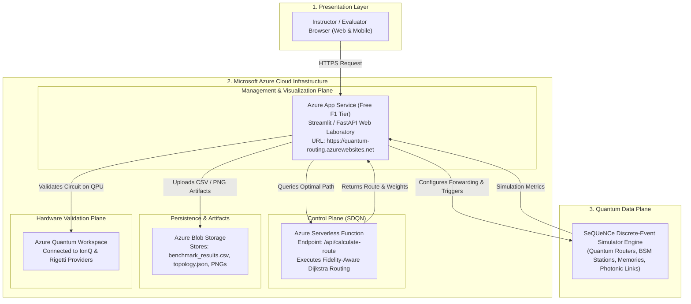

# Microsoft Azure for Students - Quantum Network Architecture & Deployment Guide

## 1. Overview & Student Benefits

This guide provides an end-to-end operational blueprint for deploying the **Quantum Network Routing Simulation** using an **Azure for Students** subscription.

University students with an official academic email (`@uit.edu.vn`) receive:
- **$100 Free Credit** (renewable yearly, no credit card required).
- **12 Months of Popular Free Services:**
  - **Azure App Service:** Up to 10 web apps on the F1 Free Tier.
  - **Azure Functions:** 1,000,000 free serverless executions per month.
  - **Azure Blob Storage:** 5 GB LRS storage for simulation logs, CSVs, and figures.
  - **Azure Linux VM (B1s):** 750 free hours/month.
- **Direct Access to Azure Quantum:** Unified cloud gateway to real quantum hardware and quantum simulators from industry leaders (IonQ, Rigetti, Quantinuum).

---

## 2. Cloud-Native System Architecture

The following diagram illustrates how the project utilizes Azure's multi-tiered cloud stack:



---

## 3. Azure Service Breakdown & Implementation Details

### A. Azure Quantum Workspace (Physical QPU Verification)
* **Purpose:** Run the Entanglement Swapping circuit on real trapped-ion or superconducting quantum processors.
* **Python Integration (`azure-quantum`):**
```python
from azure.quantum import Workspace
from azure.quantum.qiskit import AzureQuantumProvider

# Connect to your Azure Quantum Workspace
workspace = Workspace(
    subscription_id="YOUR_AZURE_SUBSCRIPTION_ID",
    resource_group="QuantumNetwork-RG",
    name="QuantumRoutingWorkspace",
    location="eastus"
)

provider = AzureQuantumProvider(workspace)

# Select a cloud quantum backend (e.g., IonQ Simulator or Rigetti QPU)
backend = provider.get_backend("ionq.simulator")

# Transpile and execute the swapping circuit on Azure
# job = backend.run(swapping_circuit, shots=1000)
# results = job.result()
```

---

### B. Azure App Service (Hosting the Web Laboratory)
* **Tier:** F1 Free Tier (Linux, Python 3.11).
* **Domain:** `https://<your-app-name>.azurewebsites.net`.
* **Deployment Steps (via Azure CLI or VS Code Azure Extension):**
```bash
# 1. Login to Azure with your student account
az login

# 2. Create a Resource Group
az group create --name QuantumNetwork-RG --location eastus

# 3. Create a Free App Service Plan (F1 Tier)
az appservice plan create --name QuantumAppPlan --resource-group QuantumNetwork-RG --sku F1 --is-linux

# 4. Create the Web App with Python 3.11 runtime
az webapp create --resource-group QuantumNetwork-RG --plan QuantumAppPlan --name quantum-routing-lab --runtime "PYTHON:3.11"

# 5. Deploy the application code
az webapp up --name quantum-routing-lab --resource-group QuantumNetwork-RG
```

---

### C. Azure Functions (Serverless SDQN Routing Engine)
* **Purpose:** Serves as the centralized Software-Defined Quantum Network (SDQN) routing controller.
* **HTTP Endpoint:**
  ```http
  POST https://<your-function>.azurewebsites.net/api/calculate-route
  Content-Type: application/json

  {
      "source": "Alice",
      "destination": "Bob",
      "policy": "fidelity_aware",
      "network_topology": "star_network"
  }
  ```
* **Response Payload:**
  ```json
  {
      "optimal_path": ["Alice", "Router1", "Bob"],
      "total_distance_km": 105.0,
      "estimated_end_to_end_fidelity": 0.9412,
      "computation_time_ms": 3.45
  }
  ```

---

### D. Azure Blob Storage (Artifact & Report Management)
* **Container Name:** `simulation-artifacts`
* **Contents:**
  - Automated exports of `benchmark_results.csv`
  - High-resolution comparison plots (`routing_comparison.png`, `fidelity_decay_analysis.png`)
  - Simulation topology definition files (`topology.json`)

---

## 4. How to Structure Your Final Presentation / Thesis Slides

Dedicate 2–3 slides in your final project defense to showcase this cloud implementation:

### Slide 1: "Architectural Innovation: Cloud-Native SDQN"
* **Talking Points:**
  - "Traditional quantum network simulations run as isolated local scripts."
  - "Our project adopts an industry-standard Software-Defined Networking (SDN) design."
  - "The routing logic is decoupled into a serverless controller running on Microsoft Azure."

### Slide 2: "Live Demonstration & Cloud Deployment"
* **Talking Points:**
  - Present the live URL: `https://quantum-routing-lab.azurewebsites.net`.
  - Invite the professors to scan a QR code to access the lab from their mobile devices during the defense.
  - Demonstrate real-time parameter tuning (attenuation, distance, routing policy) directly on the cloud interface.

### Slide 3: "Hybrid Cloud Quantum Validation (Azure Quantum)"
* **Talking Points:**
  - Explain how the Bell State Measurement (BSM) swapping protocol was compiled and submitted to Azure Quantum.
  - Present a comparison chart of simulated SeQUeNCe fidelity versus physical cloud quantum processor results.

---

## 5. Execution Checklist for Azure for Students

- [ ] **Step 1:** Activate your Azure for Students account using your `@uit.edu.vn` university email.
- [ ] **Step 2:** Create the Resource Group `QuantumNetwork-RG` in the Azure Portal.
- [ ] **Step 3:** Enable the **Azure Quantum** service and provision the free access plan (IonQ / Quantinuum credits).
- [ ] **Step 4:** Build the lightweight Streamlit dashboard and test it locally.
- [ ] **Step 5:** Deploy the web application to **Azure App Service (F1 Tier)**.
- [ ] **Step 6:** Export public links and embed them into the project documentation and slide deck.
