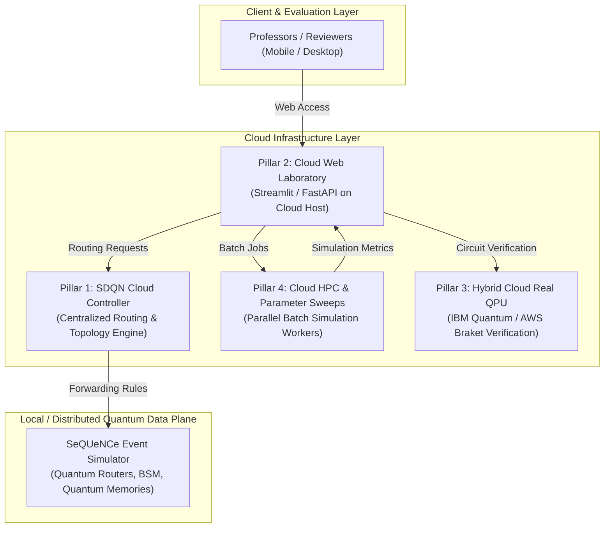
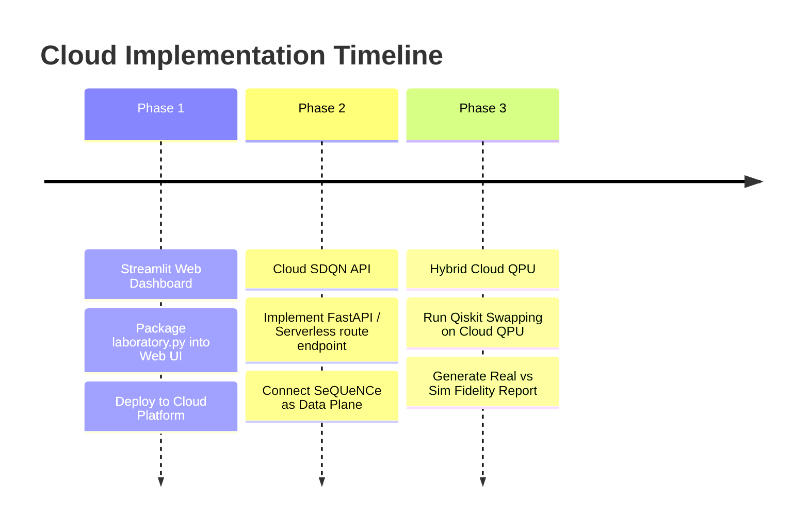

# Cloud Computing Integration Strategy for Quantum Network Routing

## 1. Executive Summary

This document establishes the strategic blueprint for integrating **Cloud Computing** into the **Quantum Network Routing Simulation (Project 13)**.

By transitioning from a local-only Python simulation script to a **Cloud-Native Quantum Network Platform**, the project elevates its academic value, architectural sophistication, and practical demonstrability. This hybrid paradigm unites two state-of-the-art domains: **Cloud Telecommunications (SDN/NFV)** and **Quantum Information Science (QIS)**.

---

## 2. Four Core Cloud Integration Pillars

### Pillar 1: Software-Defined Quantum Network (SDQN) Controller
* **Core Concept:** Decouple the **Control Plane** (Routing, Forwarding Decisions, Topology Discovery) from the **Data Plane** (Physical Quantum Hardware, Memories, Photonic Channels).
* **Implementation:**
  - The Control Plane runs as a centralized cloud service (REST API / gRPC).
  - Quantum nodes simulated in SeQUeNCe act purely as data plane forwarders.
  - When an end-to-end entanglement request arrives (e.g., Alice to Bob), the request is forwarded to the Cloud SDQN Controller.
  - The Cloud Controller computes the optimal path using **Fidelity-Aware Dijkstra Routing** and installs forwarding tables dynamically into the nodes.
* **Academic Significance:** Accurately reflects actual next-generation telecommunications research (ITU-T and IEEE quantum network standards).

---

### Pillar 2: Cloud-Native Interactive Web Laboratory
* **Core Concept:** Replace the local Tkinter GUI (`laboratory.py`) with a modern, cloud-accessible dashboard.
* **Implementation:**
  - Built using **Streamlit**, **Dash**, or **FastAPI + React**.
  - Hosted on free/student cloud tiers (Streamlit Cloud, Render, or GCP Cloud Run).
  - Allows professors and evaluators to interact with the project via a single URL without needing to install Python, PyTorch, or SeQUeNCe locally.
* **Key Features:**
  - Interactive parameter controls: fiber attenuation, distance, memory coherence time, and detector efficiency.
  - Real-time side-by-side graph rendering (Hop-Count vs. Fidelity-Aware).
  - Exportable CSV/PDF benchmark reports.

---

### Pillar 3: Hybrid Cloud Real Quantum Processor (QPU) Verification
* **Core Concept:** Validate simulated Bell measurements against physical quantum processors running on public cloud platforms.
* **Implementation:**
  - Utilize **IBM Quantum Runtime** (Free 10-minute monthly compute tier with access to 127-qubit QPUs such as `ibm_brisbane`) or **AWS Braket**.
  - Run the Entanglement Swapping circuit on a real cloud QPU to measure physical decoherence and state tomography.
  - Contrast physical QPU results against SeQUeNCe discrete-event simulations:
    $$\text{Real Cloud QPU Fidelity} \quad \text{vs.} \quad \text{SeQUeNCe Discrete-Event Fidelity}$$

---

### Pillar 4: Cloud High-Performance Computing (HPC) & Batch Parameter Sweeps
* **Core Concept:** Accelerate heavy Monte Carlo discrete-event simulations using scalable cloud compute instances.
* **Implementation:**
  - Running SeQUeNCe with millions of picosecond timeline events over large topologies is computationally demanding.
  - Deploy containerized worker jobs (Docker on AWS ECS, GCP Cloud Batch, or Azure Container Instances).
  - Perform multi-dimensional parameter sweeps across varying channel lengths (10 km to 200 km) and noise profiles concurrently.

---

## 3. Comprehensive Comparison: Local vs. Cloud-Integrated

| Dimension | Local Execution Only | Cloud-Integrated Platform |
| :--- | :--- | :--- |
| **Accessibility** | Restricted to personal development machine. | Globally accessible via public web URL (desktop/mobile). |
| **Architectural Depth** | Standalone script running locally. | Multi-tier Software-Defined Quantum Network (SDQN). |
| **Evaluation Experience** | Requires manual cloning, virtualenvs, dependencies. | Zero-install interactive evaluation for instructors. |
| **Hardware Realism** | Mathematical / discrete-event simulation only. | Hybrid validation on physical cloud QPUs (IBM/Rigetti). |
| **Academic Grade Potential** | Strong course project (8.0 - 8.8). | **Outstanding / Thesis-grade project (9.5 - 10.0)**. |

---

## 4. Technical Feasibility & Resource Cost

All four pillars can be achieved with **zero financial expense** using educational credits and free tiers:

1. **Web Dashboard:** Streamlit Community Cloud (100% Free) or Hugging Face Spaces.
2. **SDQN Controller:** Render / Google Cloud Run Free Tier / Azure App Service (F1 Tier).
3. **Real QPU Access:** IBM Quantum Platform Open Plan (Free 10 minutes/month on 127-qubit systems).
4. **Student Cloud Credits:** GitHub Student Developer Pack & Azure for Students ($100 credits).

---

## 5. Phased Implementation Roadmap

1. **Phase 1 (Immediate / High Visual Impact):** Convert `laboratory.py` into a Streamlit Web Dashboard and deploy to a free cloud hosting service.
2. **Phase 2 (Architectural Depth):** Expose the Fidelity-Aware routing algorithm as a RESTful Cloud Controller endpoint.
3. **Phase 3 (Academic Distinction):** Execute the Qiskit entanglement swapping circuit on an IBM Quantum Cloud processor and embed comparative fidelity findings into the final project report.
