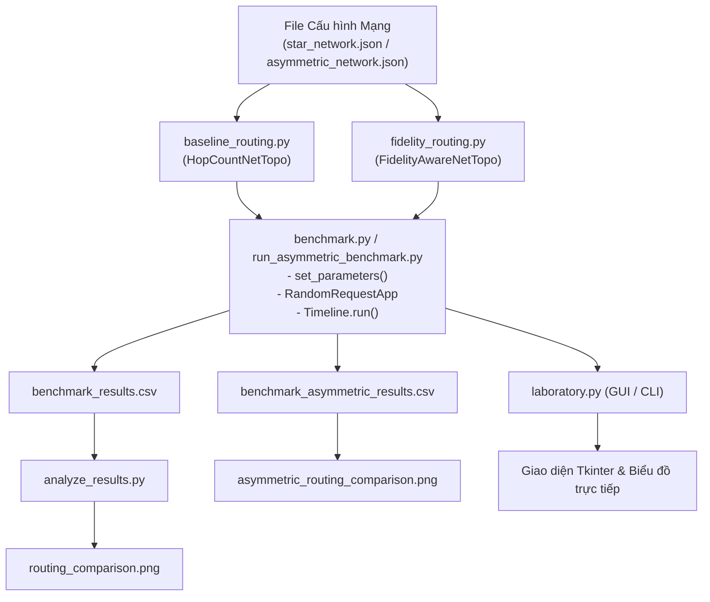

# BÁO CÁO PHÂN TÍCH TOÀN DIỆN MÃ NGUỒN HỆ THỐNG ĐỊNH TUYẾN MẠNG LƯỢNG TỬ
*(Quantum Network Routing Simulation - Project NT409)*

---

## 1. TỔNG QUAN HỆ THỐNG VÀ BỐI CẢNH DỰ ÁN

Dự án tập trung vào việc nghiên cứu, mô phỏng và đánh giá hiệu năng của các thuật toán định tuyến trong **Mạng Lượng Tử (Quantum Network)** dựa trên nền tảng mô phỏng sự kiện rời rạc **SeQUeNCe** (Simulator of Quantum Network Communication).

Khác biệt cốt lõi giữa mạng máy tính cổ điển và mạng lượng tử:
- **Mạng cổ điển:** Thông tin dạng bit có thể sao chép tự do (theo nguyên lý lưu và chuyển tiếp - Store and Forward), định tuyến thường dựa trên số bước nhảy tối thiểu (**Hop Count**) hoặc độ trễ truyền dẫn.
- **Mạng lượng tử:** Trạng thái lượng tử (qubit) không thể sao chép do **Định lý không thể nhân bản (No-Cloning Theorem)**. Để truyền tải trạng thái lượng tử giữa hai điểm cách xa nhau, mạng phải thực hiện phân phối cặp vướng lượng tử (Entangled Pair / Bell state) thông qua các trạm trung gian bằng cơ chế **Entanglement Swapping** (Hoán đổi vướng lượng tử).
- Độ trung thực (**Fidelity**) của các cặp vướng bị suy hao theo cấp số nhân theo chiều dài sợi quang và độ suy hao (**Attenuation**). Do đó, thuật toán định tuyến chọn ít hop nhất có thể chọn phải kênh quang quá dài/kém chất lượng khiến cặp vướng bị phân rã, không thể sử dụng được. Dự án giải quyết bài toán này bằng cách triển khai và so sánh thuật toán định tuyến nhận biết độ trung thực (**Fidelity-Aware Routing**) với thuật toán định tuyến truyền thống (**Hop-Count Baseline Routing**).

---

## 2. KIẾN TRÚC MÔ HÌNH HÓA MẠNG LƯỢNG TỬ (QUANTUM NETWORK MODELING)

Mô hình mạng lượng tử trong mã nguồn được xây dựng từ các thành phần chính sau:

```
+--------------------+        Kênh Lượng Tử (QChannel)        +--------------------+
|   Quantum Router   | <====================================> |      BSM Node      |
| (MemoryArray, NMs) |                                        |  (SingleAtomBSM)   |
+--------------------+                                        +--------------------+
          ^                                                              ^
          |                  Kênh Cổ Điển (CConnection)                  |
          +--------------------------------------------------------------+
```

### 2.1. Các thực thể nút mạng (Network Nodes)
1. **Quantum Router (`RouterNetTopo.QUANTUM_ROUTER`):**
   - Đại diện cho các thiết bị định tuyến lượng tử (Alice, Bob, các router chuyển tiếp R_noisy, R_clean,...).
   - Chứa mảng bộ nhớ lượng tử (**`MemoryArray`**): Lưu trữ qubit với các thông số vật lý:
     - `frequency` ($2 \times 10^3\text{ Hz}$): Tần số đọc/ghi bộ nhớ.
     - `coherence_time` (thời gian sống của trạng thái lượng tử trước khi bị mất kết hợp).
     - `efficiency` ($1.0$): Hiệu suất lưu giữ trạng thái.
     - `raw_fidelity` ($0.95$): Độ trung thực nguyên bản khi vừa sinh vướng.
   - Tích hợp ngăn xếp giao thức mạng (**Network Management Stack**): Bao gồm `ReservationProtocol` (đặt trước tài nguyên bộ nhớ) và `StaticRoutingProtocol` (bảng định tuyến tĩnh).

2. **BSM Node (`RouterNetTopo.BSM_NODE`):**
   - Trạm đo trạng thái Bell đặt ở giữa các router (mô hình *Meet-in-the-middle*).
   - Chứa bộ tách quang và các detector quang học (**`SingleAtomBSM`**):
     - `efficiency` ($0.9$): Hiệu suất phát hiện photon của detector.
     - `count_rate` ($5 \times 10^7\text{ Hz}$): Tốc độ đếm photon tối đa.
     - `time_resolution` ($100\text{ ps}$): Độ phân giải thời gian phát hiện photon đồng thời.

### 2.2. Các liên kết truyền thông (Channels)
1. **Kênh Lượng Tử (Quantum Channel - `QChannel`):**
   - Kênh cáp quang truyền dẫn photon đơn lẻ giữa router và BSM node.
   - Tham số: Chiều dài khoảng cách (`distance` tính bằng mét), hệ số suy hao (`attenuation` tính bằng dB/m hoặc 1/m), tần số xung photon (`frequency` = $10^{11}\text{ Hz}$).
2. **Kênh Cổ Điển (Classical Connection - `CConnection`):**
   - Kênh cáp quang truyền thống truyền tín hiệu điều khiển và kết quả đo BSM giữa các node với độ trễ truyền dẫn xác định (`delay` tính bằng picosecond).

---

## 3. PHÂN TÍCH CHI TIẾT TỪNG FILE MÃ NGUỒN PYTHON

### 3.1. `test_sequence.py` - Kiểm thử khởi tạo môi trường mô phỏng
- **Mục đích:** Đảm bảo thư viện lõi SeQUeNCe và môi trường Python tương thích, không xảy ra xung đột dependency.
- **Hoạt động chính:**
  - Khởi tạo dòng thời gian mô phỏng sự kiện rời rạc: `tl = Timeline(2e12)` ($2\text{ giây} = 2 \times 10^{12}\text{ ps}$).
  - Đọc và phân tích tệp cấu hình mạng mẫu `star_network.json` thông qua lớp `RouterNetTopo`.
  - Gọi `tl.init()` và `tl.run()` để chạy mô phỏng rỗng và kiểm tra danh sách các node được khởi tạo thành công (`topo.nodes`).

### 3.2. `test_base.py` - Kiểm thử cấu hình tham số phần cứng và ứng dụng sinh yêu cầu
- **Mục đích:** Thiết lập môi trường mạng với các tham số phần cứng lượng tử thực tế và kiểm thử giao thức đặt chỗ vướng lượng tử ngẫu nhiên.
- **Hoạt động chính:**
  - Hàm `set_parameters(topology, simulation_time, attenuation)`:
    - Gán thời gian dừng mô phỏng: $3000\text{ ms} = 3\text{ s}$.
    - Cấu hình mảng bộ nhớ (`frequency=2e3`, `efficiency=1`, `raw_fidelity=0.95`).
    - Cấu hình trạm BSM (`efficiency=0.9`, `count_rate=5e7`, `time_resolution=100 ps`).
    - Đồng bộ độ suy hao kênh lượng tử `attenuation=1e-4`.
  - Khởi tạo ứng dụng `RandomRequestApp`: Mỗi Quantum Router tự động phát sinh các yêu cầu tạo vướng lượng tử ngẫu nhiên đến các router khác trong mạng với các ràng buộc:
    - Khoảng thời gian: `min_dur=0.4s`, `max_dur=0.5s`.
    - Số lượng cặp vướng yêu cầu: `min_size=1`, `max_size=5`.
    - Ngưỡng độ trung thực chấp nhận: `min_fidelity=0.8`, `max_fidelity=0.85`.
  - Ghi nhận số lượng phiên đặt chỗ (`reservations`) hoàn thành của từng router.

### 3.3. `draw_custom.py` - Trực quan hóa mô hình topo mạng
- **Mục đích:** Đọc cấu hình mạng JSON và vẽ đồ thị biểu diễn cấu trúc vật lý của mạng lượng tử.
- **Hoạt động chính:**
  - Sử dụng thư viện `networkx.MultiGraph` để mô hình hóa đồ thị đa liên kết giữa các node.
  - Phân tách rõ ràng hai loại liên kết:
    - **Quantum Connection (Màu xanh lam đậm, nét liền):** Kênh lượng tử nối giữa các router và trạm BSM.
    - **Classical Connection (Màu đỏ, nét đứt nét `arc3,rad=0.1`):** Kênh điều khiển cổ điển.
  - Sử dụng bố cục lực đàn hồi `spring_layout` và xuất ảnh ra tệp đồ họa phục vụ báo cáo.

### 3.4. `baseline_routing.py` - Thuật toán định tuyến Baseline (Hop-Count)
- **Mục đích:** Triển khai cơ chế định tuyến truyền thống làm tiêu chuẩn đối sánh (baseline).
- **Lớp kế thừa:** `HopCountNetTopo` kế thừa từ `RouterNetTopo`.
- **Cơ chế hoạt động:**
  - Ghi đè phương thức `_generate_forwarding_table(self, config: dict)`:
    1. Quét danh sách các router trong `config["nodes"]` và thêm vào đồ thị `networkx.Graph()`.
    2. Duyệt qua các kênh lượng tử `qchannels`, nhóm các router kết nối qua cùng một trạm BSM.
    3. Gán trọng số cố định cho mỗi chặng (hop) giữa 2 router là **hằng số 1** (bỏ qua khoảng cách và độ suy hao quang):
       ```python
       costs[bsm] = [router1, router2, hop_count_cost] # hop_count_cost = 1 + 1 = 2
       ```
    4. Sử dụng thuật toán **Dijkstra** (`dijkstra_path(graph, src, dst)`) để tìm đường đi ngắn nhất theo số lượng chặng.
    5. Cài đặt nút chặng kế tiếp (`next_hop = path[1]`) vào bảng chuyển tiếp tĩnh `routing_protocol.add_forwarding_rule(dst_name, next_hop)` của từng Quantum Router.

### 3.5. `fidelity_routing.py` - Thuật toán định tuyến nhận biết độ trung thực (Fidelity-Aware)
- **Mục đích:** Hiện thực thuật toán định tuyến chuyên biệt cho mạng lượng tử, ưu tiên bảo toàn độ trung thực của cặp vướng.
- **Lớp kế thừa:** `FidelityAwareNetTopo` kế thừa từ `RouterNetTopo`.
- **Cơ sở lý thuyết & Hàm mục tiêu:**
  - Trong sợi quang, xác suất photon truyền qua an toàn và không bị mất mát tỷ lệ nghịch với $e^{-\alpha \cdot d}$, trong đó $d$ là khoảng cách và $\alpha$ là hệ số suy hao.
  - Sự suy giảm độ trung thực (fidelity degradation penalty) trên mỗi kênh lượng tử được tính gần đúng bằng:
    $$\text{Penalty} = \text{distance} \times \text{attenuation}$$
  - Tổng suy hao trên toàn chặng giữa hai router qua trạm BSM là tổng penalty của 2 nửa kênh:
    ```python
    fidelity_penalty = qc.distance * qc.attenuation
    costs[bsm][-1] += fidelity_penalty
    ```
- **Cơ chế hoạt động:**
  - Xây dựng đồ thị có trọng số `costs.values()` với trọng số chính là $\sum (\text{distance} \times \text{attenuation})$.
  - Thuật toán **Dijkstra** tính toán đường đi có **tổng suy hao tích lũy nhỏ nhất**, đồng nghĩa với việc tìm ra đường đi giúp trạng thái vướng lượng tử đạt **Fidelity cao nhất** khi đến đích.
  - Cập nhật quy tắc chuyển tiếp vào router: `add_forwarding_rule(dst_name, next_hop)`.

### 3.6. `benchmark.py` - Khung đánh giá hiệu năng tự động (Benchmark Engine)
- **Mục đích:** Chạy mô phỏng kiểm thử độc lập cả 2 chính sách định tuyến trên cùng điều kiện mạng, thu thập dữ liệu đo lường thực nghiệm.
- **Các hàm chủ chốt:**
  - `set_parameters()`: Chuẩn hóa toàn bộ tham số phần cứng bộ nhớ, detector và kênh truyền.
  - `run_simulation(topo_class, network_config, sim_time_ms, qc_atten)`:
    - Khởi tạo topology với lớp thuật toán tương ứng (`HopCountNetTopo` hoặc `FidelityAwareNetTopo`).
    - Kích hoạt các luồng ứng dụng `RandomRequestApp` trên từng router.
    - Tiến hành chạy mô phỏng discrete-event và đo thời gian thực thi (wall-clock runtime).
    - Trích xuất dữ liệu từ `accepted_reservations` của tầng Network Management:
      - `Start Time`, `End Time`: Thời điểm bắt đầu và kết thúc đặt trước bộ nhớ.
      - `Duration`: Độ trễ/khoảng thời gian giữ chỗ tài nguyên lượng tử.
      - `Memory Size`: Số lượng bộ nhớ lượng tử được cấp phát (đại diện cho Thông lượng / Throughput).
      - `Fidelity Target`: Ngưỡng độ trung thực mục tiêu của yêu cầu.
  - Lưu kết quả ra file `benchmark_results.csv` và in bảng tổng hợp thống kê.

### 3.7. `run_asymmetric_benchmark.py` - Kiểm thử trên mô hình mạng bất đối xứng
- **Mục đích:** Khắc phục hạn chế của topo mạng sao (vốn có tính đối xứng cao, mọi đường đều như nhau) bằng cách kiểm thử trên mạng bất đối xứng phức tạp (`asymmetric_network.json`).
- **Cấu hình mạng thử nghiệm:**
  - Node nguồn: **Alice**, Node đích: **Bob**.
  - **Tuyến đường 1 (Đường ngắn nhưng rất ồn - 2 hops):**
    - Đi qua router `R_noisy`.
    - Khoảng cách: $500\text{ m} + 500\text{ m} = 1000\text{ m}$.
    - Hệ số suy hao rất cao: $\text{attenuation} = 0.001$.
    - Tổng suy hao: $500 \times 0.001 + 500 \times 0.001 = 1.0$.
  - **Tuyến đường 2 (Đường dài hơn nhưng kênh rất sạch - 3 hops):**
    - Đi qua 2 router `R_clean1` và `R_clean2`.
    - Khoảng cách: $400\text{ m} + 400\text{ m} + 400\text{ m} = 1200\text{ m}$.
    - Hệ số suy hao rất thấp: $\text{attenuation} = 0.0001$.
    - Tổng suy hao: $3 \times (400 \times 0.0001) = 0.12$ (thấp hơn tuyến 1 gần 10 lần!).
- **Kết quả thu được:**
  - **Hop-Count Routing** chọn Tuyến 1 (2 hops) $\rightarrow$ Cặp vướng suy hao nặng, tỷ lệ thành công thấp hoặc bị hủy đặt chỗ do không đạt ngưỡng Fidelity.
  - **Fidelity-Aware Routing** chọn Tuyến 2 (3 hops) $\rightarrow$ Suy hao cực thấp, bảo toàn độ trung thực, đáp ứng thành công yêu cầu đặt chỗ.
  - Tự động xuất biểu đồ so sánh chất lượng cao `asymmetric_routing_comparison.png` và lưu dữ liệu `benchmark_asymmetric_results.csv`.

### 3.8. `analyze_results.py` - Phân tích dữ liệu và sinh báo cáo tự động
- **Mục đích:** Xử lý dữ liệu định lượng từ `benchmark_results.csv`, trực quan hóa bằng `matplotlib`, và kết xuất tệp phân tích markdown.
- **Hoạt động chính:**
  - Nhóm dữ liệu theo chính sách (`groupby("Policy")`).
  - Vẽ biểu đồ cột đôi: Thời gian giữ chỗ trung bình (Latency) và Tổng dung lượng bộ nhớ cấp phát thành công (Throughput).
  - Xuất báo cáo lý thuyết giải thích nguyên nhân thất bại của Hop-Count trong mạng lượng tử không đồng nhất.

### 3.9. `laboratory.py` - Ứng dụng "Phòng thí nghiệm tương tác" (GUI & CLI)
- **Mục đích:** Cung cấp giao diện tương tác hợp nhất cho người dùng và người đánh giá dự án mà không cần viết code dòng lệnh phức tạp.
- **Tính năng nổi bật:**
  - **Chế độ GUI (Graphical User Interface với Tkinter & Matplotlib):**
    - Cửa sổ trực quan với 3 nút chức năng: "Run Baseline", "Run Fidelity", "Run Both & Compare".
    - Nhúng trực tiếp biểu đồ so sánh (`FigureCanvasTkAgg`) vào cửa sổ ứng dụng.
    - Cập nhật trạng thái tiến trình mô phỏng theo thời gian thực.
  - **Chế độ CLI (Command Line Interface):**
    - Kích hoạt qua cờ `--cli`.
    - Menu văn bản thân thiện, cho phép chạy thử nghiệm và in bảng thống kê trực tiếp lên terminal console.

---

## 4. SO SÁNH CHUYÊN SÂU HAI THUẬT TOÁN ĐỊNH TUYẾN

| Tiêu chí | Hop-Count Baseline Routing (`baseline_routing.py`) | Fidelity-Aware Routing (`fidelity_routing.py`) |
| :--- | :--- | :--- |
| **Bản chất thuật toán** | Định tuyến đường ngắn nhất cổ điển (Shortest Path) | Định tuyến tối ưu chất lượng lượng tử (QoS/Fidelity-Optimized) |
| **Trọng số liên kết ($w$)** | $w = 1$ (đồng nhất trên mọi kênh) | $w = \text{distance} \times \text{attenuation}$ |
| **Hàm tối ưu hóa** | $\min \sum 1$ (tối thiểu hóa số node chuyển tiếp) | $\min \sum (d_i \cdot \alpha_i) \implies \max \mathcal{F}_{\text{end-to-end}}$ |
| **Phù hợp với mạng nào?** | Mạng đối xứng hoàn hảo, các kênh đồng nhất chất lượng | Mạng lượng tử không đồng nhất (Heterogeneous), sợi quang có chất lượng khác nhau |
| **Nguy cơ tiềm ẩn** | Chọn phải kênh quang cự ly ngắn nhưng chất lượng tồi, dẫn đến vướng bị suy biến và thất bại | Có thể đi qua nhiều node chuyển tiếp hơn, tiêu tốn thêm tài nguyên bộ nhớ swapping nếu không ràng buộc |
| **Hiệu năng thực tế** | Throughput thấp hơn khi mạng có nhiễu không đều | Throughput cao, đảm bảo phân phối vướng lượng tử đạt ngưỡng $\mathcal{F}_{\text{req}}$ |

---

## 5. SƠ ĐỒ LUỒNG HOẠT ĐỘNG VÀ TƯƠNG TÁC GIỮA CÁC MODULE



---

## 6. ĐÁNH GIÁ TỔNG KẾT VÀ HƯỚNG MỞ RỘNG

### 6.1. Điểm mạnh của mã nguồn hiện tại
1. **Tính module hóa cao:** Tách bạch rõ ràng giữa định nghĩa topology, thuật toán định tuyến, kịch bản benchmark và công cụ hiển thị.
2. **Kế thừa chuẩn mực:** Khai thác tối đa kiến trúc của framework SeQUeNCe thông qua việc ghi đè phương thức tạo bảng định tuyến (`_generate_forwarding_table`).
3. **Thực nghiệm thuyết phục:** Có kịch bản kiểm thử trên cả mạng đối xứng (Star) và mạng bất đối xứng (Asymmetric), làm nổi bật ưu thế của định tuyến nhận biết chất lượng kênh.
4. **Trải nghiệm người dùng tốt:** Tích hợp đầy đủ cả CLI và GUI tương tác trong `laboratory.py`.

### 6.2. Hướng phát triển và nâng cấp (Future Work)
- **Định tuyến động thích ứng (Dynamic Routing):** Hiện tại bảng định tuyến là tĩnh (Static Forwarding Rules). Có thể nâng cấp sang định tuyến động, tính toán lại đường đi dựa trên số lượng qubit còn trống trong `MemoryArray` tại thời điểm thực tế.
- **Cơ chế thanh lọc vướng (Entanglement Purification / Distillation):** Bổ sung giao thức thanh lọc khi độ trung thực rơi xuống dưới ngưỡng cho phép.
- **Định tuyến đa đường (Multipath Routing):** Phân chia yêu cầu truyền vướng lượng tử qua nhiều đường đồng thời để tối đa hóa thông lượng (entanglement throughput).

