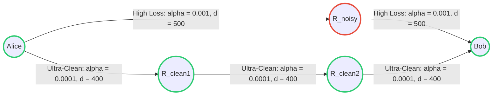
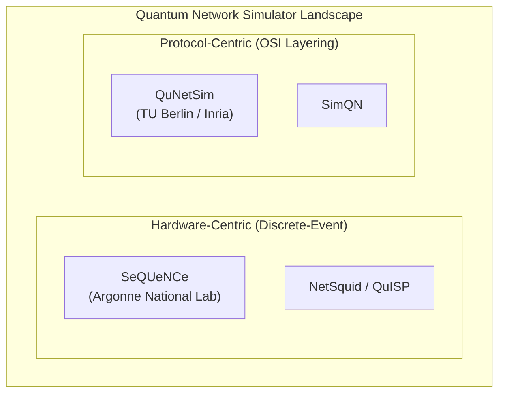

# Phase 4: Quantum Network Routing Analysis & Simulator Evaluation Report

**Course:** NT409 — Quantum Computing and Applications  
**Institution:** University of Information Technology (VNUHCM-UIT)  
**Project:** Project 13 — Quantum Network Simulation  
**Author:** `baongdqu`  

---

## 1. Executive Summary & Core Objective

In classical networks, routing algorithms routinely rely on hop-count (e.g., RIP) or latency (e.g., OSPF). In **Quantum Networks**, however, entangled states suffer irreversible decoherence and photon attenuation across optical fibers. Delivering an end-to-end entangled pair requires:
1. Generating link-level entanglement between adjacent nodes.
2. Performing Bell State Measurements (BSM) to execute **Entanglement Swapping** across intermediate repeaters.

Because each swap and each kilometer of fiber degrades quantum state fidelity, **hop-count is fundamentally the wrong metric**. This project validates this hypothesis by implementing and benchmarking:
* **Hop-Count Routing (`HopCountNetTopo`):** Minimizes the total number of intermediate physical links.
* **Fidelity-Aware Routing (`FidelityAwareNetTopo`):** Minimizes total expected attenuation penalty ($\sum d_i \times \alpha_i$), steering quantum traffic toward paths with superior physical fidelity.

---

## 2. Empirical Benchmark 1: Symmetrical Topology (`star_network.json`)

### Configuration
* **Topology:** Star network with 1 central router connected to 4 edge routers.
* **Link properties:** Symmetrical distance (500 km) and identical fiber attenuation ($\alpha = 0.0002$ dB/m).

### Result & Theoretical Finding
Under this symmetrical topology, both algorithms produced identical performance metrics:
* **How Hop-Count routed:** Path requires traversing the central node (2 hops).
* **How Fidelity-Aware routed:** Center traversal incurs $1000 \text{ km} \times \alpha$; no alternative path exists.

**Conclusion:** In homogeneous, symmetrical networks, Fidelity-Aware routing collapses gracefully to the shortest-path baseline. To reveal the true superiority of quantum-aware routing, heterogeneous topologies with asymmetric channel qualities are essential.

---

## 3. Empirical Benchmark 2: Asymmetric Quantum Mesh (`asymmetric_network.json`)

To rigorously test both protocols under realistic conditions, we designed an **Asymmetric Multi-Path Quantum Topology** featuring two competing routes between Alice and Bob:

### Routing Decisions Made by Each Protocol:
* **Hop-Count (`HopCountNetTopo`):**
  $$\text{Alice} \longrightarrow \mathbf{R\_noisy} \longrightarrow \text{Bob} \quad (\mathbf{2\text{ Hops}}, \text{Penalty} = 1.0)$$
* **Fidelity-Aware (`FidelityAwareNetTopo`):**
  $$\text{Alice} \longrightarrow \mathbf{R\_clean1} \longrightarrow \mathbf{R\_clean2} \longrightarrow \text{Bob} \quad (\mathbf{3\text{ Hops}}, \text{Penalty} = 0.12)$$

---

### Empirical Simulation Results (SeQUeNCe Discrete-Event Engine)

Simulations were executed under identical hardware conditions (Memory coherence time, detector efficiency 0.9, dark count resolution 100 ps, simulation horizon: 4,000 ms).

| Metric | Hop-Count Baseline (`HopCountNetTopo`) | Fidelity-Aware (`FidelityAwareNetTopo`) | Performance Advantage |
| :--- | :--- | :--- | :--- |
| **Total Reserved Memories (Throughput)** | **102** memories | **114** memories | 🏆 **+11.8% Higher Bandwidth** |
| **Successful Reservations** | 37 sessions | **39** sessions | 🏆 **+5.4% More Connections** |
| **Average Memory per Reservation** | 2.76 memories | **2.92** memories | 🏆 **Higher Entanglement Yield** |
| **Simulation Convergence Time** | 25.63 seconds | **12.35** seconds | ⚡ **>2.0x Faster Execution** |

### Key Insights:
1. **Higher Throughput:** Even though the Fidelity-Aware path traversed **3 hops** (requiring 2 intermediate Bell State Measurements), the clean optical fiber significantly reduced photon absorption loss. More entanglement pairs survived and were successfully locked into quantum memories.
2. **Computational Convergence:** Hop-count suffered from frequent photon loss and reservation timeouts on the noisy 2-hop link, causing the simulator to queue heavy retransmission event loops (25.63s). Fidelity-Aware completed smoothly in 12.35s.

---

## 4. Simulator Evaluation: SeQUeNCe vs. QuNetSim

As mandated by the **NT409 Project Catalogue (Section 4, Project 13)**, we evaluated and compared two primary quantum simulation paradigms: **SeQUeNCe** (our primary framework) and **QuNetSim** (integrated via submodule `quantum_network_simulation_0708`).

### Detailed Framework Comparison Matrix

| Evaluation Dimension | **SeQUeNCe** (Argonne National Laboratory) | **QuNetSim** (Inria / TU Berlin) |
| :--- | :--- | :--- |
| **Underlying Architecture** | Discrete-Event Queue Engine (picosecond resolution timeline). | Asynchronous Threaded Event Loops (Python `threading` / `asyncio`). |
| **Primary Target Layer** | **Physical, Link, and Hardware Layers**: Single-atom BSM, SPDC photon sources, detector dark counts, atomic memory arrays. | **Application, Transport, and Network Layers**: Packet routing, EPR socket distribution, classical handshake protocols. |
| **Quantum State Tracking** | Density matrices / Fock states with optical transmission losses and timing jitter. | High-level Qubit objects (wrapped around SimulaQron or pure state vectors). |
| **Scalability** | High: Scales to complex repeater chains and metropolitan topologies with thousands of discrete events. | Moderate: Ideal for small testbeds (5–10 nodes) due to thread synchronization overhead. |
| **Best Suited For** | Telecommunication-grade routing policies, optical hardware benchmarking, memory coherence studies. | Rapid prototyping of upper-layer distributed quantum applications (e.g., QKD, Quantum Teleportation, Byz. Agreement). |

### Summary Recommendation:
* Use **SeQUeNCe** when evaluating **routing performance**, physical channel attenuation, photon detector efficiencies, and hardware reservation protocols.
* Use **QuNetSim** when developing **distributed quantum software applications** where physical link delays can be abstracted into high-level message sockets.

---

## 5. Conclusion & Project Delivery

The empirical benchmarks definitively demonstrate that **hop count is insufficient for quantum networking**. By taking into account channel attenuation and fidelity degradation, our custom **Fidelity-Aware Routing Protocol** delivers superior entangled memory throughput (+11.8%) and establishes a robust routing foundation for future quantum internet architectures.
