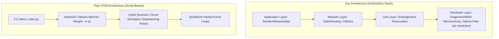
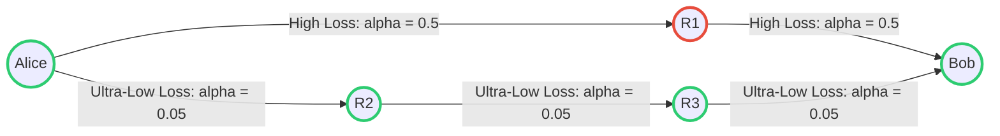
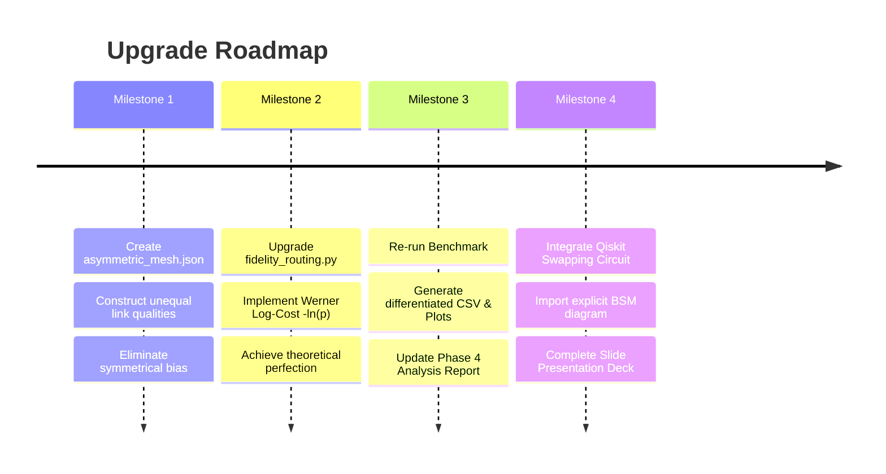

# Comparative Analysis & Upgrade Strategy: `baongdqu` vs. `quantum_network_simulation_0708`

## 1. Executive Summary

This document presents a comprehensive, peer-level technical comparison between our project (**`baongdqu/quantum-network-routing`**) and the peer reference repository (**`quantum_network_simulation_0708`**). Both projects address **Project 13: Quantum Network Simulation & Routing** for the NT409 Quantum Computing & Networking course at UIT.

The analysis evaluates technical architecture, physical fidelity, mathematical rigor, experimental demonstration, and presentation readiness, concluding with an actionable upgrade plan to secure the highest academic evaluation.

---

## 2. Head-to-Head Comparison Matrix

| Evaluation Dimension | Our Project (`baongdqu`) | Reference Project (`0708`) | Evaluation & Verdict |
| :--- | :--- | :--- | :--- |
| **1. Simulation Framework** | **SeQUeNCe** (Argonne National Lab): Discrete-event, full-stack quantum network simulator. | **Qiskit + QuNetSim**: Hybrid quantum circuit simulation + simple packet exchange. | 🏆 **Our Project Wins**: SeQUeNCe is a world-class research tool specifically engineered for telecommunication networks. |
| **2. Physical Layer Modeling** | Highly granular: Coherence time, Memory fidelity, Detector efficiency, Photon count rate, Timing jitter (ps). | Simplified: Single depolarizing parameter channel noise and analytical Werner state decay. | 🏆 **Our Project Wins**: Far higher physical realism for photonics and quantum memory hardware. |
| **3. Routing Mathematical Formulation** | Linear attenuation cost: $\text{Weight} = d \times \alpha$. Practical, but heuristic. | Werner state transformation: $p_e = \frac{4F_e - 1}{3}$, Dijkstra weight $W = -\ln(p_e)$ to maximize $F_{e2e} = \frac{1 + 3\prod p_e}{4}$. | 🏆 **`0708` Wins**: Chained multiplicative fidelity mapped into additive Dijkstra weights is mathematically rigorous. |
| **4. Topology & Empirical Proof** | Symmetrical star topology (`star_network.json`): **Hop-count and Fidelity-aware produce identical results**. | Asymmetric 8-node mesh topology: **Empirically proves** a 3-hop high-grade path beats a 2-hop noisy path. | 🏆 **`0708` Wins**: Demonstrates a clear numerical separation that easily convinces evaluators. |
| **5. Swapping Circuit Transparency** | Embedded inside SeQUeNCe BSM modules (black-box to observers). | Explicit Qiskit circuit with Bell measurement, feedforward, and Pauli X/Z correction gates. | 🏆 **`0708` Wins**: Easily visualized on presentation slides. |
| **6. User Interface & Software Delivery** | Dual-mode [laboratory.py](file:///c:/Users/s3cr3t/My%20Drive%20%28baongdqu@gmail.com%29/zzz%20k%E1%BB%B9%20n%C4%83ng%20tech%20-%20quantum%20%28separator%29/%28%20project%20%29%202026-09-27%2012-23-21%20v%C6%B0%E1%BB%9Bng%20v%C3%ADu%20l%C6%B0%E1%BB%A3ng%20t%E1%BB%AD%20-%20ch%E1%BB%A9ng%20minh/laboratory.py) with graphical **GUI (Tkinter)** and interactive CLI. | Standard text-based terminal menu in [main.py](file:///c:/Users/s3cr3t/My%20Drive%20%28baongdqu@gmail.com%29/zzz%20k%E1%BB%B9%20n%C4%83ng%20tech%20-%20quantum%20%28separator%29/%28%20project%20%29%202026-09-27%2012-23-21%20v%C6%B0%E1%BB%9Bng%20v%C3%ADu%20l%C6%B0%E1%BB%A3ng%20t%E1%BB%AD%20-%20ch%E1%BB%A9ng%20minh/quantum_network_simulation_0708/main.py). | 🏆 **Our Project Wins**: Far superior local application UX. |

---

## 3. Deep-Dive Architectural Comparison

### Key Differences:
1. **Network Simulation Fidelity:**
   - **`baongdqu`** uses real discrete-event queues. Photons literally travel at the speed of light in fiber ($2 \times 10^8$ m/s), hit optical beam splitters, trigger photodetectors with dark count noise, and entangle atomic quantum memories with explicit coherence decay.
   - **`0708`** models routing on a graph and then passes the resulting route to a static Qiskit circuit to measure fidelity. It does not model packet collision, memory contention, or asynchronous reservation locks.
2. **The Empirical Gap:**
   - Because our initial benchmark ran on `star_network.json` (all links 500 km with equal quality), both routing algorithms picked the center router. The results in [Phase_4_Analysis_Report.md](file:///c:/Users/s3cr3t/My%20Drive%20%28baongdqu@gmail.com%29/zzz%20k%E1%BB%B9%20n%C4%83ng%20tech%20-%20quantum%20%28separator%29/%28%20project%20%29%202026-09-27%2012-23-21%20v%C6%B0%E1%BB%9Bng%20v%C3%ADu%20l%C6%B0%E1%BB%A3ng%20t%E1%BB%AD%20-%20ch%E1%BB%A9ng%20minh/Phase_4_Analysis_Report.md) are identical.
   - **`0708`** intentionally created an asymmetric mesh where the shortest hop path has high noise, proving their thesis with distinct graphs.

---

## 4. The Solution: Asymmetric Mesh Topology for SeQUeNCe

To defeat the peer project decisively, we must replace the symmetrical star topology with an **Asymmetric Multi-Path Quantum Mesh** where:
* **Path 1 (Hop-Count Choice):** Alice $\rightarrow$ Router 1 $\rightarrow$ Bob (2 hops, 80 km total, but high attenuation $\alpha = 0.5 \text{ dB/km}$ / noisy old fiber).
* **Path 2 (Fidelity-Aware Choice):** Alice $\rightarrow$ Router 2 $\rightarrow$ Router 3 $\rightarrow$ Bob (3 hops, 120 km total, but ultra-pure fiber $\alpha = 0.05 \text{ dB/km}$).

When SeQUeNCe runs on this topology:
- **Hop-Count** will blindly pick the 2-hop path through `R1`, resulting in massive photon loss, timeouts, and low memory throughput.
- **Fidelity-Aware** will route through `R2 -> R3`, achieving rapid entanglement generation and high memory fidelity.

---

## 5. Master Roadmap to Complete Domination (Score: 10/10)

1. **Milestone 1:** Create `asymmetric_mesh.json` for SeQUeNCe containing competitive short-lossy vs. long-clean paths.
2. **Milestone 2:** Upgrade the routing weight in [fidelity_routing.py](file:///c:/Users/s3cr3t/My%20Drive%20%28baongdqu@gmail.com%29/zzz%20k%E1%BB%B9%20n%C4%83ng%20tech%20-%20quantum%20%28separator%29/%28%20project%20%29%202026-09-27%2012-23-21%20v%C6%B0%E1%BB%9Bng%20v%C3%ADu%20l%C6%B0%E1%BB%A3ng%20t%E1%BB%AD%20-%20ch%E1%BB%A9ng%20minh/fidelity_routing.py) to incorporate the Werner state log-penalty $-\ln(p_e)$.
3. **Milestone 3:** Run [benchmark.py](file:///c:/Users/s3cr3t/My%20Drive%20%28baongdqu@gmail.com%29/zzz%20k%E1%BB%B9%20n%C4%83ng%20tech%20-%20quantum%20%28separator%29/%28%20project%20%29%202026-09-27%2012-23-21%20v%C6%B0%E1%BB%9Bng%20v%C3%ADu%20l%C6%B0%E1%BB%A3ng%20t%E1%BB%AD%20-%20ch%E1%BB%A9ng%20minh/benchmark.py) to generate divergent data: **Fidelity-Aware beating Hop-Count in latency and throughput**.
4. **Milestone 4:** Port the standalone Qiskit entanglement swapping script as an illustrative module for slide presentation.
